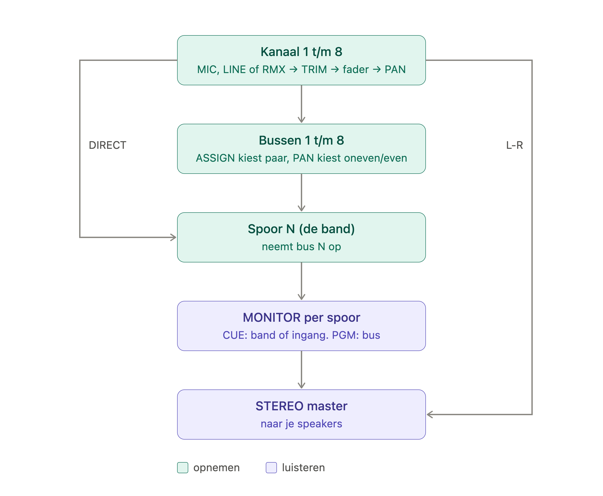

# PROJECT - DAW 388

Versie: 0.23.2
Laatst bijgewerkt: 29-10-2026

## Doel

Een eenvoudige standalone 8-sporen DAW naar het model van de Tascam 388: opnemen via een audio-interface of de ingebouwde audio, mixen op een 8:8:2-mixer met tape-karakter en exporteren als stereo bounce of losse sporen. De volledige functionele scope en de genomen besluiten staan in [HANDOVER.md](HANDOVER.md).

## Tech stack

- Rust (stable, edition 2024), Cargo workspace
- Audio I/O: `cpal` 0.18 (CoreAudio op macOS, WASAPI op Windows)
- UI: `egui` / `eframe` 0.37
- Audiobestanden: `hound` (WAV) en `symphonia` (AIFF en AIFF-C)
- Realtime-communicatie: `rtrb` (lock-free ringbuffer)
- Bestandsdialogen: `rfd`
- Builds: GitHub Actions. Bij elke push een controle op Windows (opmaak, Clippy, tests); bij een versielabel `v*` of handmatig de release voor macOS en Windows met downloadbare apps

## Workspace

| Crate | Map | Taak |
|---|---|---|
| `daw388-engine` | `crates/engine` | Transport, 8 sporen en stereomix, pieken en energie per meterpunt. Platformonafhankelijk, geen allocaties of locks in de audiothread |
| `daw388-tape` | `crates/tape` | Tape-model bij afspelen (acht sporen tegelijk), met dbx |
| `daw388-fx` | `crates/fx` | Plate reverb en tape echo: buffers bij het aanmaken, geen allocaties in `process` |
| `daw388-project` | `crates/project` | Import van WAV (hound) en AIFF, FLAC en MP3 (symphonia, `decode.rs`; het formaat volgt uit de eerste bytes) naar mono, samplerate-conversie, de projectmap (`project.json`, `audio/`, `backups/`), de exportbestanden (`export.rs`: `rubato`-resampler, WAV- en AIFF-schrijvers, dither), het regiomodel (`regions.rs`), het uitrekenen van een spoor (`render.rs`) en golfvorm-overzichten (`peaks.rs`) |
| `daw388-ui` | `crates/ui` | egui-interface, praat met het platform via de `Platform`-trait. De console (strips in vaste vlakken op een vast raster en de twee master-kolommen) staat in `console.rs`. De vintage skin staat in `skin/`: palet, lettertype (IBM Plex), VU-meters, spoelen, meeschalen en de toetsen en de schuifschakelaar (`keys.rs`) |
| `daw388` | `crates/app-desktop` | Desktop-entrypoint: cpal-uitvoer, bestandsdialogen en het eframe-venster |

## Architectuur

- De UI-thread bezit een `EngineHandle`, de audio-callback bezit de `Engine`.
- Commando's (PLAY, STOP, locate, spoor laden, kanaal, monitor, mixer, master) gaan via een lock-free ringbuffer naar de audiothread.
- Positie, afspeelstatus en meters komen terug via atomics. Per kanaal meet de engine pieken en energie na TRIM en EQ (voor de fader) en na fader en mute; per spoor meet hij pieken en energie van wat de MONITOR hoort. In de 388-stand tonen de TRK-meters in de brug dat laatste, zoals de TRK/PGM-meters van de 388 (blokschema, pagina 47 van de handleiding): de bus naar het spoor of de band. In de eenvoudige stand tonen ze het kanaal, voor of na de fader (TRACK METERS PRE/POST, alleen in die stand). Het PEAK-lampje van een meter brandt bij de piek van zijn eigen bron boven ongeveer -0,5 dBFS, zoals de PEAK IND van de 388 bij +8 dBV; het OL-lampje bij TRIM blijft het kanaal na de EQ boven -3 dBFS.
- Sporenbuffers die de engine loslaat gaan via een tweede ringbuffer terug naar de UI-thread en worden daar vrijgegeven. Er wordt dus nooit geheugen vrijgegeven in de audiothread.
- De engine kent geen audioapparaten. `app-desktop` roept `Engine::render` aan vanuit de cpal-callback; een latere browserversie doet hetzelfde vanuit WebAudio.
- Bij het wisselen van apparaat bouwt de app een nieuwe engine op de samplerate van het apparaat en stuurt de sporen (opnieuw geconverteerd), mixinstellingen en positie opnieuw.
- Sporen zijn mono, zoals op de 388. Stereobestanden worden bij het laden gemiddeld naar mono.
- Een spoor bestaat uit regio's: een stuk van een bron (een audiobestand) op een plek op de band, gesorteerd en zonder overlap. Wat op een plek komt, vervangt wat er lag; de bron blijft, dus een rand is terug te halen. De bewerkingen zijn pure functies in `regions.rs`, zodat undo de oude lijst kan bewaren.
- De engine kent geen regio's. Na elke wijziging rekent de UI het spoor op de achtergrond uit tot één buffer (`render.rs`: stilte tussen regio's, een fade van 3 ms aan een vrije rand, een crossfade van 3 ms waar twee regio's elkaar raken, niets waar een regio zijn bron naadloos voortzet) en stuurt die met `SetTrack`. De bronnen staan in een gedeelde tabel (`crates/ui/src/sources.rs`), elk één keer gedecodeerd en één keer omgezet naar de samplerate van de engine.
- De SPOREN-weergave (`crates/ui/src/drawer.rs`) tekent met de egui-painter en zet muis en toetsen om in bewerkingen (`edit.rs`), elk één undo-stap op basis van de pure functies in `regions.rs`. De tijd-as, het raster, vastklikken en wat onder de muis ligt staan los in `timeline.rs`.
- Undo en redo (`crates/ui/src/history.rs`): 10 stappen voor alles wat de inhoud van de sporen verandert. Een stap bewaart de regio's van de sporen die hij raakte; de bronnen worden gedeeld.
- Het formaat van een audiobestand wordt herkend aan de eerste bytes (`RIFF` of `FORM`), niet aan de extensie.

## Projectmap

```
Mijn liedje/
├── project.json        # mixinstellingen en verwijzingen naar de audio
├── audio/              # WAV-bestanden van de sporen
└── backups/            # eerdere versies van project.json (laatste 10)
```

- `project.json` bevat `format` (`daw388-project`), `version` (formaatversie, nu 3), `app_version`, `master_db` (STEREO MASTER), `meter_post` (kanaalmeters na de fader, standaard `false`), `transport` (zie hierboven), `metronome`, `editor` (de sporen: `open` voor de SPOREN-weergave, `height` sinds 0.19.0 ongebruikt, `zoom` in pixels per seconde of leeg voor het hele nummer, `snap` voor RASTER; ontbreekt: dicht, 320, hele nummer, RASTER aan), `tape` (`mode` clean/388, ontbreekt: clean; `speed` 3.75/7.5/15, `kind` 456/250/911, `saturation`, `wow_flutter`, `noise`, `crosstalk` van 0 tot 2, `dbx` twee booleans, ontbreekt: aan), `mixer` (`mode` simple/388, ontbreekt: 388; `odd_db`, `even_db`, `mon` pgm/cue, `mono`, `aux_master_db`, `eff_master_db`, `phones_db`, `listen` stereo/aux/eff, `meter` lr/aux_eff, `effects` met `plate` (`decay_s`, `predelay_ms`, `tone`), `echo` (`time_ms`, `sync` off/quarter/eighth/dotted_eighth, `feedback`, `tone`) en `rtn` (twee keer `gain_db` en `pan`; ontbreken ze, dan zijn de RTN's dicht)) en per spoor `number`, `name`, `regions` (elk `file` met een relatief pad, `start` op de band en `offset` in het bestand in seconden, `length` en `name`), `fader_db`, `pan`, `mute` en `input` (de kanaalinstellingen), `channel` (`source` mic/line/rmx, `trim_db`, `aux_db`, `aux_pre`, `eff_db` (ontbreken ze, dan zijn de sends dicht: `SEND_CLOSED_DB`, -60 dB), `eq` met `low`, `mid` en `high` (elk `freq_hz` en `gain_db`; ontbreekt `eq`, dan is hij vlak), `assign`, `lr`, `direct`, `auto`) en `monitor` (`gain_db`, `pan`, `mute`).
- `length` ontbreekt alleen bij de enige regio van een spoor die vanaf 0:00 een heel bestand speelt waarvan de lengte nog niet bekend is: een spoor dat nog geladen wordt of waarvan het bestand ontbreekt. Zo'n spoor neemt niets nieuws aan (geen REC FUNCTION, geen Laad) tot het bestand geladen is of het spoor gewist.
- Een project met formaatversie 2 (0.16.0 en ouder) opent met per spoor één regio over het hele bestand vanaf 0:00. Een regio die niet klopt (geen lengte, overlap, negatieve tijden) wordt bij het openen weggelaten met een melding.
- Een project met formaatversie 1 (0.7.0 en ouder) opent als eenvoudig project: fader, pan en mute blijven de kanaalfader, elk kanaal krijgt de eenvoudige instelling (LINE, AUTO, DIRECT, L-R) en houdt zijn ingang. Een project van 0.8.0 of 0.9.0 (zonder `mode`) opent in de 388-stand.
- Opslaan kopieert audio van buiten het project naar `audio/`, elk bestand één keer, ook als meerdere regio's het gebruiken. Het origineel blijft staan. Bij een naamconflict krijgt de kopie een achtervoegsel (`take-2.wav`).
- `project.json` wordt eerst naar een tijdelijk bestand geschreven en daarna hernoemd, zodat een crash nooit een half bestand achterlaat.
- Autosave volgt 30 seconden na een wijziging, alleen als het project al een map heeft.
- Backups: bij elke handmatige opslag en hooguit elke 5 minuten bij autosave.
- Een project uit een nieuwere formaatversie wordt geweigerd met een melding.

## SoundCraft

[SoundCraft](https://github.com/storytold/soundcraft) (MIT OR Apache-2.0) is bekeken als referentie. Het is een groot project (ruim 110.000 regels) dat vastzit aan eigen forks van egui en winit en aan eigen hulpbibliotheken, dus er is geen code rechtstreeks overgenomen. Wel gevolgd:

- Het patroon UI-handle tegenover audio-callback met commandokanaal en atomics.
- Apparaat zoeken op naam met terugval op het standaardapparaat (`app-desktop/src/main.rs`, met bronvermelding).
- Een scratchbuffer per callback zodat de callback niet alloceert, met omzetting naar het sampleformaat van het apparaat.

## Transport

Naar de handleiding van de 388 (Memory/Transport Controls):

- De bandpositie loopt in samples op de samplerate van de engine, met een fractie, zodat de pitch-knop de snelheid kan variëren (plus of min 15%, VARI/FIX). Tussen samples wordt met Hermite-interpolatie gelezen. De teller volgt de bandpositie, zoals de 388 de bandlengte meet.
- RESET zet het nulpunt op de huidige plek; de teller toont de tijd vanaf het nulpunt, met een minteken daarvoor.
- CUE onthoudt de huidige plek. STC zoekt het CUE-punt op (zonder CUE-punt: het begin). RTZ zoekt het nulpunt op. PLAY tijdens een zoekactie speelt bij aankomst.
- REW en F FWD spoelen op 30 keer de normale snelheid, stil, tot STOP, het begin of het einde van het langste spoor.
- REPEAT loopt van het nulpunt tot het CUE-punt. In de 388-modus spoelt de band terug en speelt opnieuw, en zet elke transporttoets behalve PLAY en RTZ REPEAT uit. In de cycle-modus springt de positie direct terug (ook bij RTZ en STC) en blijft REPEAT aan.
- Nulpunt, CUE-punt, REPEAT-modus, pitch en VARI/FIX worden in `project.json` bewaard onder `transport`.

## Opnemen

Naar de handleiding van de 388 (REC FUNCTION, REC, INSERT, Punch-in):

- REC FUNCTION maakt een spoor klaar (lampje knippert); tijdens de opname brandt het. REC start de opname op de klaargezette sporen, vanuit stop samen met PLAY. Zonder klaargezette sporen gaat de machine record-ready (REC knippert) en start REC FUNCTION de opname op dat spoor; nogmaals drukken punch-out.
- Punch-out met PLAY (speelt door), STOP, REW, F FWD, RTZ of STC, of automatisch bij het CUE-punt (de band stopt, of spoelt terug met REPEAT).
- INSERT: klaargezette sporen spelen de band tot de punch-in en schakelen dan naar de ingang. Wat je hoort volgt de MONITOR-sectie (zie Mixer). Meeluisteren via DAW 388 kan uit (direct monitoring van de interface); een spoor dat opneemt speelt dan niets.
- AUTO PUNCH: na REC wordt alleen tussen nulpunt en CUE-punt opgenomen, bij elke doorgang met REPEAT opnieuw.
- De ingang draait op de samplerate van de uitvoer. De input-callback vult een lock-free ring, de output-callback leest per uitvoerframe een invoerframe, zodat band en ingang op dezelfde klok lopen. Bij twee apparaten met een eigen klok stuurt de engine bij door af en toe een frame over te slaan.
- Latencycompensatie: de tijd van opname tot callback (ingang) plus van callback tot weergave (uitgang), gemeten met de tijdstempels van cpal, plus de vulling van de ring, plus een handmatige correctie in milliseconden. Een opname wordt zoveel eerder op de band gelegd.
- De engine stuurt per spoor een stroom `Start(positie)`, samples en `Stop` naar een schrijver op een eigen thread, die elke take als 32-bit float WAV in een tijdelijke map zet. Daarna schrijft een achtergrondtaak de take als 24-bit WAV `NN_Naam_opnameN.wav` in `audio/` (alleen het opgenomen stuk), en wordt hij een regio op zijn plek die vervangt wat eronder lag, zoals op band. Takes van hetzelfde spoor worden op volgorde verwerkt. Een take die door latencycorrectie voor 0:00 zou beginnen, verliest dat stuk. Een take die binnenkomt nadat er een ander project is geopend, wordt niet geplaatst (het bestand blijft staan).
- Cmd+Z (Bewerken, Ongedaan maken) zet tot 10 stappen terug: opnames, laden, Laad en Wis. Cmd+Shift+Z doet ze opnieuw. Tijdens een opname kan dat niet. De bestanden blijven in `audio/` staan.
- Opnemen kan ook met de pitch-knop op VARI, zoals op band: de engine geeft de bandsnelheid mee met de take (`RecItem::Start`), en bij het opslaan rekent `recording::to_tape_time` de take met de hoge-kwaliteits-resampler om naar bandtijd. Wat op +10% is ingespeeld, beslaat 10% meer band en klinkt bij normale weergave langzamer en lager. Het bestand blijft op de samplerate van het project. Tijdens het opnemen staat de snelheid vast: de pitch-knop en VARI/FIX zijn uitgeschakeld, en de latencycompensatie wordt met de snelheid omgerekend.
- Een project zonder map vraagt bij REC eerst om op te slaan.
- Ingangsapparaat, meeluisteren en latencycorrectie zijn app-voorkeuren; de ingang per kanaal, INSERT en AUTO PUNCH worden per project bewaard.

## Export

- Knop EXPORT bij de transportsectie of Bestand, Exporteren. Het venster Export kiest: stereo bounce (met of zonder tape-karakter), losse sporen (per spoor aan of uit) met een verwerking, het bereik, het formaat en de map.
- Offline: `crates/ui/src/export.rs` maakt een tweede engine zonder apparaat op de exportsamplerate, op een achtergrondthread, en geeft hem dezelfde sporen en instellingen. De sporen worden daar uit hun regio's uitgerekend, met de bronnen via `rubato` op de exportsamplerate, zodat de export klinkt zoals de app. Eerst 3 s voorloop terwijl de band stilstaat (faders, sends en de echo-tijd zetten zich), dan het bereik, dan stopt de band en klinken galm en echo uit tot 0,5 s onder -90 dBFS (hooguit 10 s).
- Losse sporen: *met mixer en tape* is de mix met dat spoor op SOLO (stereo, met zijn eigen galm en echo; de som van alle stems is de bounce); *alleen tape* is het spoor via een neutraal kanaal door het tape-model (mono); *droog* is het spoor zelf, zijn regio's met hun fades (mono).
- Bereik: het hele nummer (van het begin tot het einde van het langste spoor) of van het nulpunt tot het CUE-punt; dan begint elk bestand op 0:00, of met stilte ervoor zodat het op de band past.
- WAV of AIFF (32 bit float als AIFF-C `fl32`), 16 bit met TPDF-dither, 24 bit of 32 bit float, 44,1, 48 of 96 kHz; samplerate-conversie met `rubato`. Bestanden in `export/` van het project als `Projectnaam_mix` en `Projectnaam_01_Naam`; een bestaand bestand krijgt `-2`. Er wordt via een tijdelijk bestand geschreven; bij annuleren of een fout worden de bestanden van die export verwijderd.
- Een kanaal op MIC of LINE zonder AUTO is bij export stil (geen ingang).

## Tape

- Het tape-model werkt alleen op de weergave van de band, voor RMX, AUTO en de MONITOR-sectie. Opnames van een ingang blijven schoon, zodat het karakter altijd aan te passen of uit te zetten is. Een pingpong van band naar band neemt de weergave op, en dus het karakter, zoals op een echte machine.
- Venster Tape (knop TAPE bij de transportsectie, of Bestand, Tape-instellingen): Clean of 388, snelheid 3¾, 7½ of 15 IPS, tapesoort 456, 250 of 911, en SATURATIE, WOW & FLUTTER, RUIS en CROSSTALK van 0 tot 200% (100% is de machine).
- Per spoor: crosstalk van de buren (-75 dB), saturatie (pre-emphasis, zachte asymmetrische tanh met een aansturing per soort: 456 1,0, 250 1,6, 911 1,2, en de-emphasis), head bump (+1,5 dB op 40, 60 of 100 Hz), soortkleur op 8 kHz (250 -1 dB, 911 +1 dB), afrol in het hoog (10, 15 of 20 kHz), en ruis (-58 dBFS RMS bij 100% zonder dbx, alleen op sporen met audio terwijl de band speelt).
- dbx per groep (sporen 1-4 en 5-8, standaard aan): coderen voor de band (pre-emphasis, RMS-detector van 10 ms, 2:1 rond -20 dBFS, hooguit 40 dB versterking) en decoderen erna (1:2, de-emphasis). Het signaal komt er vrijwel ongeschonden uit; de ruis wordt mee uitgezet, dus ver weg in stiltes en hoorbaar onder muziek: het ademen. Saturatie en kleur zitten in het gecodeerde deel, wat een lichte mistracking geeft zoals echt.
- Wow en flutter verschuiven de afspeelpositie van de hele band (0,5 en 6 Hz, samen ongeveer 0,05% WRMS bij 7½ IPS; 3¾ twee keer zoveel, 15 IPS 0,6 keer).
- Op Clean gaat de band bit voor bit door. Een nieuw project staat op 388, 7½ IPS, 456; een project van 0.12.0 of ouder opent op Clean.

## Metronoom

- De klik wordt in de engine gemaakt (een korte sinus met snelle uitsterving, hoger op tel 1) en gaat alleen naar de uitvoer: niet in de mixmeters en nooit in een opname.
- Maat 1 begint aan het begin van de band, zodat RESET het ritme niet verschuift. Het tempo telt kwartnoten per minuut, ook in x/8; een tel is dan een achtste.
- De klik klinkt tijdens opnemen en aftellen, en tijdens gewoon afspelen alleen als dat is aangezet.
- Aftellen (1 of 2 maten) gebeurt bij REC vanuit stop. De band wacht; het maatraster loopt voor de band uit, zodat de klik na het aftellen zonder sprong doorloopt en de opname begint waar de band stond.
- Tempo, maatsoort, CLICK, volume, aftellen en "ook bij afspelen" worden per project bewaard onder `metronome`.

## Mixer

Twee standen, per project, met de schakelaar Eenvoudig | 388 in de bovenbalk:

- **Eenvoudig** (standaard voor een nieuw project): per spoor één strook met ingang (MIC of LINE), TRIM, EQ, PAN, REC, MUTE en fader. Elk kanaal staat op AUTO met DIRECT en L-R; de PGM-bussen, de MONITOR-sectie en MON zijn verborgen.
- **388**: de volledige routering hieronder. Van Eenvoudig naar 388 verandert niets aan het geluid. Van 388 naar Eenvoudig vraagt de app eerst als de 388-routering daarbij verdwijnt; fader, PAN, MUTE, EQ, TRIM en ingang blijven, RMX wordt LINE.
- **SOLO** per spoor (een DAW-gewoonte, de 388 heeft hem niet): zolang er een spoor gesoloed is, hoor je alleen de gesoloode sporen, via hun L-R-kanaal en hun MONITOR-rij. Bussen en opnames merken er niets van. SOLO wordt niet in het project bewaard en vloeit kort over, zodat er geen tik is.
- **AUTO** (een afwijking van de 388, zoals DIRECT): het kanaal speelt de band, en de ingang zodra zijn spoor de ingang hoort (op REC, met INSERT pas vanaf het inprikpunt). De ingang gaat door TRIM en de voorversterker, dan naar DIRECT, dan door de EQ; de band gaat alleen door de EQ. De opname krijgt dus geen EQ, en bij het afspelen zit hij er één keer op. Een AUTO-kanaal zonder ingang speelt de band en neemt stilte op.

Naar het blokschema en Features and Controls in de handleiding van de 388:

- Kanaal: bron (MIC, LINE of RMX), TRIM, fader, PAN, ASSIGN 1-2/3-4/5-6/7-8 en L-R. RMX is de weergave van het spoor met hetzelfde nummer; zolang dat spoor zijn ingang hoort (REC FUNCTION aan en opnemend of zonder INSERT) is RMX stil, zodat er geen lus ontstaat.
- PAN verdeelt over de oneven (links) en even (rechts) bus van een ASSIGN-paar. De PGM MASTERS ODD en EVEN regelen bussen 1, 3, 5, 7 en 2, 4, 6, 8.
- Spoor N neemt PGM-bus N op, of met DIRECT kanaal N na TRIM en EQ, voor de fader. DIRECT is een afwijking van de 388: een snelle opnameroute naast de bussen. Opnemen vraagt geen ingang: van band naar band bouncen kan ook zonder ingangsapparaat.
- MONITOR: per spoor GAIN, PAN en mute. Met MON op PGM hoort de monitor de bus (of het DIRECT-signaal); op CUE volgt hij de tabel uit de handleiding: de ingang zolang het spoor zijn ingang hoort, anders de band als die speelt, anders niets.
- De STEREO MASTER krijgt de L-R-kanalen, of de MONITOR-mix als geen kanaal op L-R staat. Daarna MONO.
- Meeluisteren via de interface: live bronnen worden wel opgenomen maar nergens gehoord; de engine houdt per bus een opname- en een luistersom bij.
- Zonder L-R hoor je de sporen via de MONITOR-sectie (de opnamestand van de 388). Een nieuw project begint in de eenvoudige stand; daar staat elk kanaal op L-R.
- Latencycompensatie geldt alleen als de opname een live bron bevat (bepaald bij de punch-in). Een bounce van band naar band ligt sample-precies onder de bron.
- MIC gaat na TRIM door een nagebootste voorversterker: tot -6 dBFS schoon, daarboven een zachte tanh-knie naar een plafond onder 0 dBFS, licht asymmetrisch (even harmonischen). LINE en RMX zijn schoon.
- EQ: drie RBJ-piekfilters met Q 0,9, elk ±15 dB. LOW 50 Hz tot 1 kHz (standaard 100 Hz), MID 500 Hz tot 5 kHz (1 kHz), HIGH 2,5 tot 15 kHz (8 kHz). De engine krijgt frequentie en gain, vloeit ze per sample over en rekent elke 32 samples de coëfficiënten opnieuw uit op zijn eigen samplerate. Een band die vlak staat wordt overgeslagen, dus een vlakke EQ laat het signaal bit voor bit door.
- In de strook is elke band één concentrische knop: slepen in het midden is gain, op de ring frequentie (logaritmisch). Dubbelklik zet het aangeklikte deel terug.
- OL: de PRE-piek van het kanaal (na de EQ) boven -3 dBFS, 0,5 s nagloeiend. De UI leidt hem af uit de PRE-meterwaarde; er is geen apart signaal voor.
- Sends, in beide standen: AUX met PRE (na TRIM en voorversterker, voor EQ, fader en MUTE) of POST (na fader en MUTE, voor PAN), en EFF na fader en MUTE. Ze vloeien over zoals de fader. Een live bron gaat bij meeluisteren via de interface ook niet naar AUX of EFF. SOLO raakt de sends niet, zodat een koptelefoonmix blijft staan.
- AUX MASTER en EFF MASTER gaan elk naar een eigen interface-uitgang (vanaf 3; app-voorkeuren `aux_output` en `eff_output`). Een uitgang die het apparaat niet heeft wordt overgeslagen. AUX en EFF op dezelfde uitgang worden opgeteld.
- Hoofduitgang: STEREO, AUX of EFF (mono op beide kanten), dan MONITOR/PHONES, dan de klik met zijn eigen volume. De stereometers meten voor PHONES; met METER op AUX-EFF tonen ze AUX en EFF na hun master.
- Effecten (ingebouwd): een plate reverb op AUX en een tape echo op EFF, zoals op de 388. Ze krijgen de AUX- en EFF-som na de masters, maar alleen van sporen die je hoort (SOLO); de interface-uitgangen houden alles. De returns gaan via EFFECT RTN 1 (plate, stereo, PAN als balans) en RTN 2 (echo, mono) naar de stereobus voor de STEREO MASTER, ook als de MONITOR-mix de stereobus vult. Effecten komen nooit op een opname of bus.
- Plate: topologie naar Dattorro (pre-delay, diffusie, een tank van twee helften), DECAY 0,5 tot 6 s, PRE-DELAY 0 tot 100 ms, TONE.
- Echo: maximaal 2 s, TIME 40 tot 800 ms of SYNC 1/4, 1/8, 1/8 gepunteerd op het metronoomtempo, FEEDBACK tot 0,9, TONE. TIME glijdt naar een nieuwe waarde zoals een bandmotor; de lus wordt donkerder, verzadigt zacht en heeft een lichte wow.
- Wie AUX als koptelefoonmix gebruikt, draait RTN 1 dicht. Een fysiek effect kan ook: AUX of EFF naar een interface-uitgang, terug via een kanaal op LINE.

### Routing in de praktijk

In de eenvoudige stand is het: ingang kiezen, REC, spelen. Zolang een spoor op REC staat hoor je de ingang, anders de band. De fader en PAN zijn wat je hoort. Voor pingpong en de bussen schakel je naar 388; hieronder gaat het over die stand.



Er zijn twee routes: wat er op band komt (kanaal, bus, spoor) en wat je hoort (MONITOR, STEREO MASTER). Alle acht sporen zijn mono, net als op de 388. Stereo ontstaat bij het luisteren en mixen door PAN; een stereobron neem je op als twee sporen.

- **Opnemen op één spoor (bijvoorbeeld gitaar op 3):** kanaal 3 op LINE of MIC, ingang kiezen, DIRECT aan. Spoor 3 wapenen en opnemen. Hoe hard je het hoort regel je in MONITOR rij 3.
- **Stereobron opnemen (bijvoorbeeld op 5 en 6):** kanaal 5 op de linker ingang en kanaal 6 op de rechter, allebei DIRECT. In MONITOR spoor 5 links en 6 rechts zetten.
- **Pingpong naar mono (sporen 1 tot 3 naar 4):** kanalen 1 tot 3 op RMX, ASSIGN 34 aan, PAN helemaal rechts (bus 4). De faders maken de balans. Spoor 4 wapenen en opnemen.
- **Pingpong naar stereo (sporen 3 tot 5 naar 7 en 8):** kanalen 3 tot 5 op RMX, ASSIGN 78 aan; PAN is nu de stereoplek tussen bus 7 (links) en 8 (rechts). Beide sporen wapenen, want met alleen 8 neem je alleen de rechterkant op. In MONITOR 7 links en 8 rechts zetten, en M aan bij 3 tot 5 als je ze niet dubbel wilt horen.
- **Mixdown:** alle kanalen op RMX met L-R aan. Kanaalfaders en PAN zijn dan de mix; de MONITOR-mix is niet meer te horen zolang er een kanaal op L-R staat.
- **CUE of PGM:** op CUE hoort een gewapend spoor zijn ingang (met INSERT de band tot het inprikpunt) en een niet gewapend spoor de band. Op PGM hoort elk spoor altijd zijn bus.

## Bewerken

- Twee weergaven: MIXER (de hele console, meeschalend met het venster) en SPOREN (de sporen over het hele venster, met daarboven de VU-brug, de teller en de transporttoetsen). De leren armsteun onderaan of Tab wisselt; de weergave wordt per project bewaard.
- Per spoor in SPOREN een kleine fader voor het volume en een PAN-knop, dezelfde waarden als in de mixer.
- Werkbalk: SPLITS (S), KNIP (Cmd+X), KOPIEER (Cmd+C), PLAK (Cmd+V), WIS (Delete), RASTER, zoom (−, PAST, +), rechts de stand van undo en het tempo. De sneltoetsen werken alleen in SPOREN en geen tekstveld de focus heeft.
- Tijdlijnbalk: klikken zet de band daar, slepen selecteert een tijdvak over alle sporen. Met RASTER aan toont hij maten (maat 1 begint aan het begin van de band, zoals de klik), anders minuten en seconden; het nulpunt en het CUE-punt staan erin.
- Regio's: klikken selecteert (Shift voegt toe of haalt weg), klikken op een leeg stuk haalt de selectie weg. Slepen verschuift de selectie, ook naar een ander spoor; een rand slepen kort in of trekt terug tot het einde van de opname. Wat op een plek komt, vervangt wat er lag.
- SPLITS splitst de geselecteerde regio's op de afspeelpositie, zonder selectie alle sporen. KNIP, KOPIEER en WIS werken op het tijdvak als er een is, anders op de geselecteerde regio's. Knippen van een tijdvak is een splice (de rest schuift aan); een geplakt tijdvak wordt op de afspeelpositie ingevoegd. Geplakte regio's komen op de afspeelpositie, elk op zijn eigen spoor.
- Vastklikken op tellen (met RASTER), randen van regio's, nulpunt, CUE-punt en afspeelpositie, binnen 8 pixels; Alt ingedrukt is vrij.
- Zoomen met Cmd en scrollen rond de muis, scrollen schuift door de tijd. Tijdens het afspelen bladeren de sporen mee.
- Bestanden uit de Finder komen op het laatst aangeklikte spoor (en de sporen erna) vanaf de afspeelpositie, samen één undo-stap. Waar je loslaat kan niet: winit geeft bij het slepen van bestanden geen muispositie door.
- Dubbelklik op de naam van een spoor wijzigt hem.
- Een spoor dat nog geladen wordt of waarvan het bestand ontbreekt, neemt niets nieuws aan; bewerkingen over alle sporen wachten tot het geladen of gewist is. Tijdens een opname kan er niet bewerkt worden.
- Undo-namen: Splitsen, Knippen, Splice, Plakken, Invoegen, Wissen, Verwijderen, Verschuiven, Inkorten, Naam, Importeren, Laden, Wis en Opname spoor N.

## Laden

Een bron (audiobestand) wordt op een achtergrondthread gedecodeerd en naar de samplerate van het apparaat omgezet (via `Platform::spawn`), één keer, hoeveel regio's hem ook gebruiken. Daarna wordt elk spoor dat hem gebruikt opnieuw uitgerekend. Bronnen en sporen hebben elk een volgnummer; een te laat resultaat wordt genegeerd. Bij een apparaatwissel worden de bronnen opnieuw omgezet en de sporen opnieuw uitgerekend.

- Laad in de strook zet een bestand als regio op het spoor, vanaf de afspeelpositie op het moment van kiezen; het vervangt alleen dat stuk.
- "8 audiobestanden laden..." en bestanden op de opdrachtregel vervangen de sporen 1 tot 8 (op naamvolgorde) door één regio vanaf 0:00, samen één undo-stap.

## Audio-uitvoer

- De gekozen uitvoer (apparaat, samplerate, buffergrootte, en de uitgangen voor AUX en EFF) is een app-voorkeur, geen projectinstelling. Ze staat in `settings.json` in de configuratiemap van het systeem (macOS: `~/Library/Application Support/DAW 388/`, Windows: `%APPDATA%\DAW 388\`).
- Openen gaat in deze volgorde: het gekozen apparaat, anders het standaardapparaat (met een melding), anders de stille klok. De stille klok laat de engine in echte tijd draaien zonder geluid, zodat transport, teller en meters blijven werken.
- Meldt cpal dat het apparaat weg is (`DeviceNotAvailable` of `StreamInvalidated`), dan opent de app meteen opnieuw volgens die volgorde, op dezelfde bandpositie. Zolang de uitvoer niet het gekozen apparaat is, kijkt de app elke 2 seconden of het terug is en schakelt dan terug.
- Een samplerate die het apparaat niet biedt, of een buffergrootte buiten zijn bereik, valt terug op de standaard van het apparaat.

## Bekende beperkingen

- Import van WAV, AIFF, FLAC en MP3. MP3 begint en eindigt met een beetje stilte (encodervertraging); andere formaten (OGG, AAC) nog niet.
- Samplerate-conversie bij het afspelen gebruikt Hermite-interpolatie; de export gebruikt `rubato`.
- Het tape-karakter zit alleen in de weergave; bij de export kies je of het meegaat. Pingpong kan alleen in de 388-stand. Zie de roadmap.
- Een bus die een live ingang en de band tegelijk opneemt, wordt gecompenseerd voor de ingang; het banddeel komt dan de apparaatlatency te vroeg op het nieuwe spoor.
- Op macOS vraagt het systeem bij het eerste gebruik van een ingang om toegang tot de microfoon. Zolang de app als los programma vanuit de terminal draait, hoort die toestemming bij de terminal.
- Op macOS is het standaard app-menu uitgezet, zodat Cmd+Q via de opslaan-vraag loopt. Afsluiten door uitloggen of herstarten van de Mac gaat nog wel buiten die vraag om; autosave beperkt dan het verlies tot de laatste 30 seconden.

## Versiebeheer

- GitHub: privé repo `tonvanderkolk/daw-388`
- `design/ref/` (handleiding en foto's) staat in `.gitignore` en hoort niet in de repo.
- Wachtwoorden en tokens horen in `CREDENTIALS.md` (staat in `.gitignore`).
